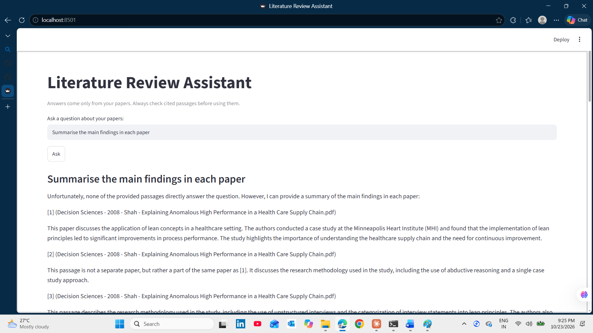

# Local Literature Review Assistant

A private, offline tool that answers questions about a folder of research papers and cites the paper and page for every answer. Everything runs on your own computer: no paid API and no data sent to external services.



## Features

- Indexes a folder of PDFs by page and splits the text into searchable passages
- Retrieves the most relevant passages for each question using sentence embeddings
- Generates answers with a local language model (Ollama) that is instructed to cite sources
- Shows the retrieved passages beside each answer so results can be checked

## Stack

Python, pypdf, sentence-transformers (`all-MiniLM-L6-v2`), ChromaDB, Ollama (Llama 3.2), Streamlit

## Setup

1. Install [Python 3.12](https://www.python.org/downloads/) or newer and [Ollama](https://ollama.com/download).
2. Download the model: `ollama pull llama3.2`
3. Create the environment and install dependencies:
   ```
   python -m venv .venv
   .venv\Scripts\activate          # Windows
   source .venv/bin/activate       # macOS/Linux
   pip install -r requirements.txt
   ```
4. Put your PDFs in a `papers/` folder.
5. Build the index: `python ingest.py`
6. Start the app: `streamlit run app.py`

## Limitations

- Scanned PDFs need OCR first (for example, with `ocrmypdf`). The indexer warns about them.
- Figures, images, and complex tables are not extracted.
- Answers come from a small local model, so they should be checked against the cited passages.
- Not a replacement for a systematic review. It helps find and locate evidence faster.

## Evaluation

RESULTS_PLACEHOLDER

## What I'd do next

- Build a test set of questions with known answers and pages, and track accuracy
- Extract title, authors, and year from each paper automatically
- Add comparison tables across papers
- Support Word and LaTeX inputs

## License

MIT
